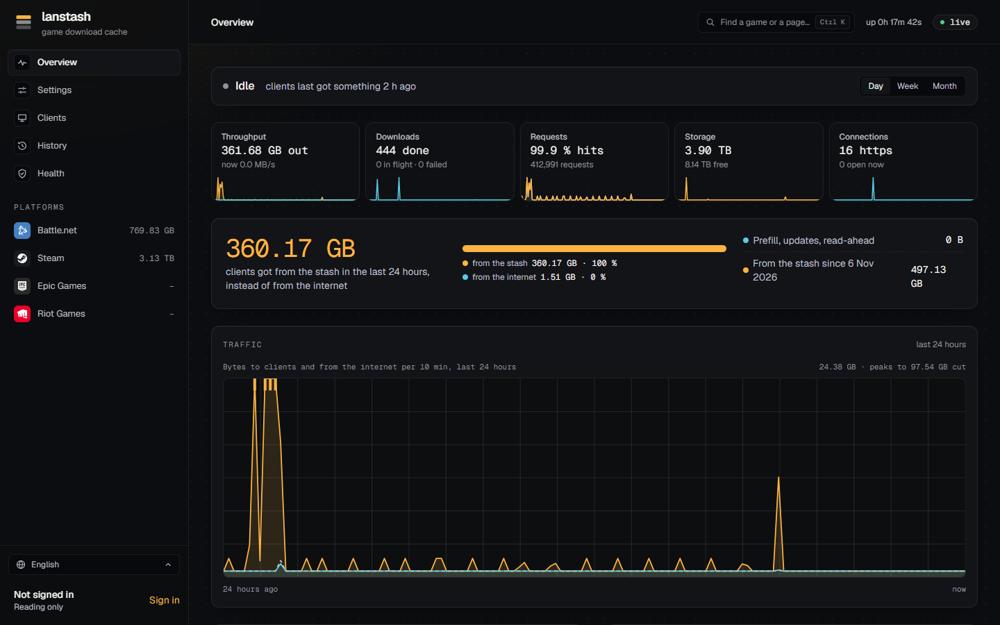

# lanstash

**Download a game once. Every PC on your LAN gets it at LAN speed.**

lanstash is a game download cache for home and LAN-party networks. When one PC downloads a game from Steam,
Battle.net, Epic Games or Riot, lanstash keeps it; the next PC that installs the same game gets it from your own
storage instead of the internet. It runs on a Linux box on your network, keeps its games on local disks or a NAS
share, and comes with a web UI that shows what it holds, what it served and what is going on right now.



## Why lanstash

Caching game downloads on a LAN is not new. lanstash is what came out of running such a cache for real, on network
storage, for a household of PCs, and wanting it to do more than store bytes:

- **Made for network storage.** Steam's millions of one-megabyte chunks are packed into large segment files instead
  of one file each, big archives go to sparse files, and stored data is sent straight from disk to the network.
  A NAS share holds terabytes of games without drowning in small files.
- **It knows your games.** For every game, lanstash knows its current build and whether the stash holds all of it.
  It prefills new builds before anyone plays, keeps games current on its own, and clears out old files no current
  build needs.
- **It prefills ahead.** Pick games from your Steam, Battle.net or Epic library and queue them overnight. A Mac
  joining the LAN, or a friend who plays in another language? Prefill that install too.
- **You can see it work.** Throughput, hit rates, downloads and storage, live and over a day, a week or a month;
  which PC downloaded what; a history of every update.
- **It is careful with your data.** Every stored byte carries a checksum, checked as it is stored and again in the
  background. Downloads are checked against the platforms' own hashes where they publish them.
- **It is yours to share.** Accounts for the people on your LAN (admins, viewers, players), invite links, and games
  that a player can keep to themselves.

## Getting started

Grab a release, install it as a service, make yourself an admin:

```sh
sha256sum -c lanstash-<version>-linux-x86_64.tar.gz.sha256
tar -xzf lanstash-<version>-linux-x86_64.tar.gz && cd lanstash-<version>-linux-x86_64
sudo ./lanstash install --config lanstash.conf --web web
sudo lanstash user add admin --admin
lanstash doctor
```

Then point your LAN's DNS at it (lanstash sets up AdGuard Home or Pi-hole for you) and open the web UI.

**[The documentation](https://darki73.github.io/lanstash/)** walks through all of it, with screenshots:
installing, configuring, DNS, the web UI page by page, and every command and setting.

## Status

lanstash is young (0.2.0) but runs every day on a household LAN with several terabytes of Steam and Battle.net games.

| | Cached | Prefill | Builds tracked |
| --- | --- | --- | --- |
| Steam | yes | yes | yes |
| Battle.net | yes | yes | yes |
| Epic Games | yes | yes | yes |
| Riot | yes | no | no |

Linux with systemd is the supported home; phones are not cached (they fetch over HTTPS from other CDNs). The
[known limits](https://darki73.github.io/lanstash/known-limits/) list everything it does not do yet.

## Building and contributing

lanstash is Rust (a hexagonal workspace whose architecture rules are tests) with a React web UI.

```sh
cargo test --workspace     # every test, the architecture rules among them
cargo build --release      # target/release/lanstash
cd web && pnpm install && pnpm test && pnpm build
```

Continuous integration runs the same checks on every push and pull request; a version tag makes a release. The
code is mapped in [`docs/map/`](docs/map/README.md), and what was measured along the way in
[`docs/measurements.md`](docs/measurements.md).

## Licence

Apache-2.0, see [`LICENSE`](LICENSE). Platform names and marks belong to their owners.
