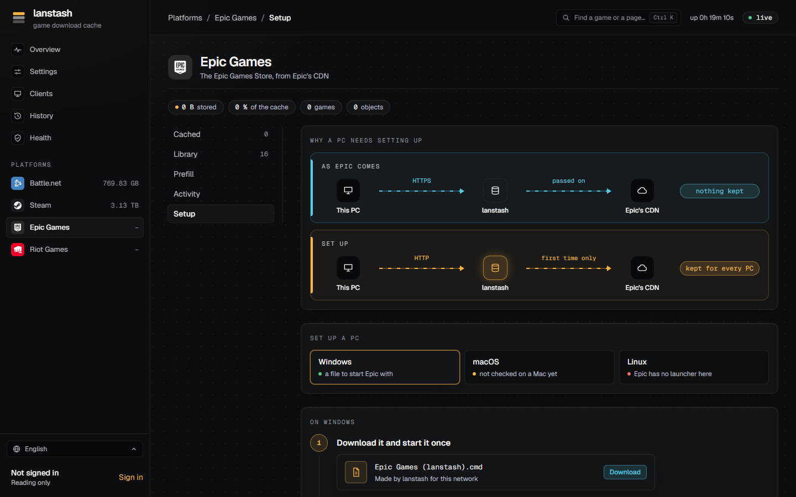

# First steps

With lanstash installed, configured and the DNS pointing at it, a few things are left: an admin account for the web
UI, a Steam account for Steam's prefill and builds, a setup file for each PC that runs Epic Games, and a first
prefill to see it all work. The web UI is at `http://192.0.2.10:8081` in these examples (your `admin_listen`).

## Make the first admin

lanstash keeps its own accounts for the web UI and the API. The first admin is made on lanstash's own machine:

```sh
sudo lanstash user add admin --admin
```

It asks for the password twice, without showing it. Passwords are kept only as hashes, in the `secrets`
directory. Without `--admin`, `user add` makes a viewer; `lanstash user list` shows the accounts.

!!! note "Who may do what"
    Anyone on the LAN may look at the web UI, read only. Changing anything needs an account with the permission
    for it: an **admin** may do everything, a **player** prefills the games its linked platform accounts own, a
    **viewer** reads. Requests from lanstash's own machine may do everything, so the command line needs no
    sign-in. More accounts are best added from the web UI with an invite link (see
    [Accounts](../guide/accounts.md)).

## Sign in to the web UI

Open the web UI in a browser and choose **Sign in** at the foot of the sidebar. Sign in as `admin` with the password
you chose. A session lasts 30 days from its last use.

## Sign in to Steam

Steam's prefill and builds need a Steam account signed in, so lanstash can read what your games need.

1. Open **Platforms**, **Steam**, then the **Account** part.
2. Choose **Add an account** to sign in. A QR code appears.
3. Open the Steam mobile app of that account, tap the Steam Guard shield, then the QR scanner, and scan the code.
4. Approve the sign-in in the app.

No password is involved: lanstash keeps only the sign-in Steam hands out. Several accounts may be signed in, and
each one's games are fetched as that account. The same is possible from the command line with
`lanstash steam login` (see the [command line](../reference/cli.md#steam)).

Epic Games has an **Account** part too: it opens Epic's own sign-in page in a new tab, and you paste the code that
page shows back into lanstash.

## Set up an Epic Games PC

Epic's launcher downloads over HTTPS as it comes, which a caching proxy can only pass on, so nothing is kept. Each
Windows PC that runs Epic needs a small setup file from lanstash once.



1. Open **Platforms**, **Epic Games**, then the **Setup** part, and choose **Windows**.
2. **Download** the file made for your network and start it once. Windows may ask whether to run a downloaded
   file: Run. It puts itself in place and makes a shortcut on the desktop and in the Start menu.
3. From now on, start Epic with that shortcut in place of Epic's own. Each time, it closes the launcher if it is
   running, adds a few lines to Epic's settings file (`Engine.ini`), then starts the launcher as usual.

To check it: install or update any game. It shows under **Activity** while it downloads and under **Cached** once
it is done. If it shows in neither, the launcher is still downloading over HTTPS.

!!! note
    The macOS file is not made yet, and Epic has no launcher for Linux.

## A first prefill

A prefill puts a game's current build into the stash before anyone asks for it.

=== "Web UI"

    Open a platform's **Cached** or **Library** part, find the game and choose **Prefill**. The **Prefill** part
    shows its progress. While one runs, further games can be queued behind it.

=== "Command line"

    On lanstash's machine:

    ```sh
    lanstash prefill steam/<app id>
    ```

    It starts the prefill in the running lanstash and follows it. Ctrl-C stops following, not the prefill;
    `--detach` starts it and returns at once, and `lanstash prefill stop` stops it.

See [Prefill](../guide/prefill.md) for more.

## Check it on the overview

The **Overview** page shows what lanstash does now: a status line, then tiles for throughput, downloads,
requests, storage and connections. While a prefill or a download runs, you see it fetch from the internet; when a
PC installs a game the stash already holds, it is served from the stash. The savings, traffic and games served most
over a day, week or month are there too. See [Overview](../guide/overview.md).

To check the whole installation from the command line:

```sh
lanstash doctor
```
