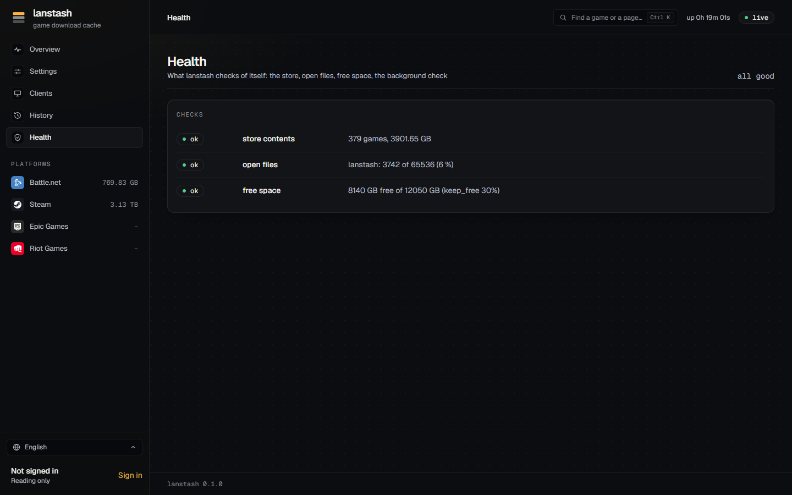
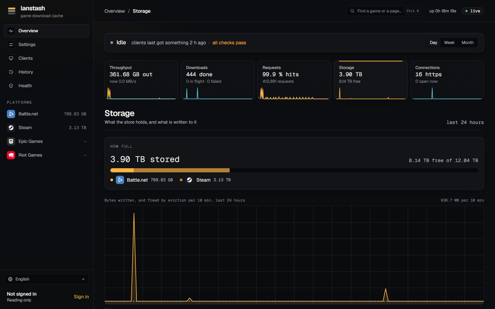

# Health and checks

lanstash checks itself: the **Health** page and `lanstash doctor` say whether the store loaded cleanly and whether
open files and disk space are fine, every stored byte carries a checksum that a full check can read back, and
eviction keeps the disk from filling up. This page covers all of these.



## The Health page

**Health** in the sidebar lists the checks lanstash makes of itself, each **ok**, **warning** or **failure**,
with a summary on top (**all good**, **something to look at**, **something is wrong**). The Overview's status
line shows the same result.

| Check | Looks at |
|---|---|
| **store contents** | The games and bytes in the store, and any file that could not be loaded or damaged record found (a warning). |
| **open files** | lanstash's open files against its limit: a warning from 80 %, a failure from 95 %. |
| **free space** | The store's disk against `keep_free`: a warning below it. |
| **background check** | Only with `verify_every` set: a warning when the last round found problems. |

!!! tip
    A file not opened because lanstash may open no more files is not damage: raise the open-file limit instead.
    The service that `lanstash install` sets up allows 65,536.

## lanstash doctor

`lanstash doctor` checks the installation from outside, read-only:

```sh
lanstash doctor
```

It looks at the version, the service's state, the configuration, `admin_listen`, each listen port, the admin API,
open files against the service's limit, each store root (writable, and its free space against `keep_free`), the
store's contents (with the background check's problems), the upstream DNS, the cache-domains lists and the log
directories. It prints one line per check (`[ok  ]`, `[WARN]` or `[FAIL]`), then the counts, and exits with 1 when
any check fails.

## Checksums

Every stored byte has a checksum: each small object in a segment file, and each range of a large object file.
Downloads are checked before they are kept where the platform allows it: Steam chunks against the CRC Steam sends,
Epic chunks and Battle.net files against the hashes in their manifests.

## lanstash store verify

`lanstash store verify` reads every stored byte and checks it against its checksum. It only reads, so it is safe
while lanstash serves.

```sh
lanstash store verify                       # as fast as the disks go, 4 threads
lanstash store verify --rate 100            # at most 100 MB a second
lanstash store verify --threads 8           # more threads
lanstash store verify --accept              # do not ask first (systemd, scripts)
```

Before it starts, it says how much it will read and asks you to go on. Without a terminal to ask (under systemd,
or in a script) it starts only with `--accept`. It reports damaged records, unreadable files and journal problems,
and exits with 1 when it finds any. It repairs nothing: a damaged object is fetched again from the internet when a
client asks for it.

!!! note
    A record still being written is not damage, so a check while lanstash downloads is fine.

## The background check

With **Check stored bytes** (`verify_every`) set in **Settings**, lanstash runs the same check slowly in the
background while it serves: `weekly`, `monthly`, every *n* days (`<n>d`), or `off` (the default).

- **Check speed** (`verify_rate`) caps how much it reads a second (`20M`, `50M`, `100M`; `50M` by default), so
  clients keep the disks.
- It resumes where it was after a restart.
- Whatever looks wrong is checked again against a fresh listing before it is reported, so a file deleted meanwhile
  is not reported as damage.
- The Overview's **Storage** page shows the **Store check**: when it last finished, how far a running round got,
  when the next one is due, and any **Damage found**. lanstash's log names each damaged record or file.



## Eviction

When the store runs short of room, lanstash deletes what was used least recently. Two limits, both optional, set
in **Settings** (the **Storage** group) or the configuration; the stricter one wins:

| Setting | Means | Examples |
|---|---|---|
| **Size limit** (`max_size`) | The most the stash may hold. Empty: no limit. | `8000G`, `2T` |
| **Keep free** (`keep_free`) | The space to keep free on each store disk, which other data may share. | `30%`, `500G` |

- Eviction works on whole units: a segment file of small objects, or one large object file. The segment being
  written is never evicted, and anything used in the last 10 minutes is protected.
- Nothing is evicted for its age alone: game downloads are named by their content and never go stale, so lanstash
  keeps them as long as there is room.
- The Storage page shows what was **Evicted**, with **Segments evicted**, **Files evicted** and any **Eviction
  failures**.

Settings changed on the web UI apply when lanstash restarts; **Settings** offers **Restart** for that.
