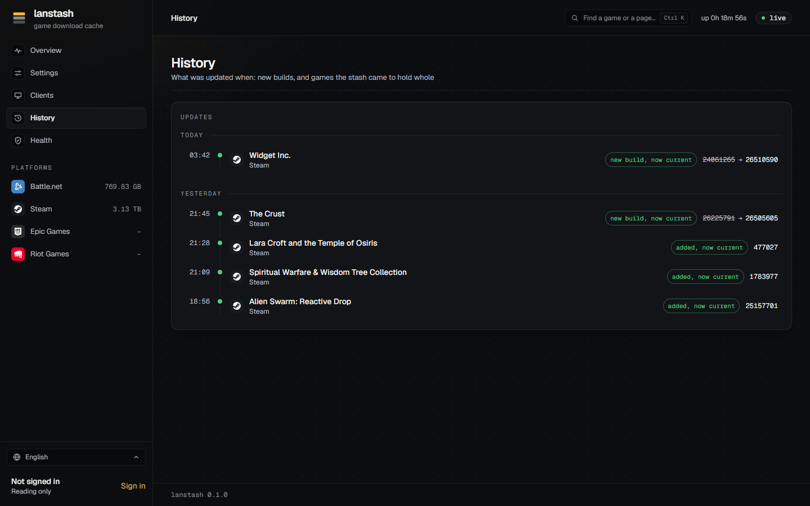

# History

The **History** page lists what was updated when: new builds of the games in the stash, games seen for the first
time, and when the stash came to hold a build whole. lanstash notes these as it checks the builds, so the page
grows on its own and keeps across restarts.

## Reading the page

The updates are listed newest first and grouped by day: **Today**, **Yesterday**, then dates such as "Mon 3 Nov".
Times are in your own time zone.

Each line names the game (it links to the game's page), its platform, the time, the version, and what happened:

| Change | Means |
|---|---|
| **new build** | The platform published a new build of a stashed game. The build before it is shown struck through. |
| **added** | lanstash saw the game for the first time. |
| **current** | The stash came to hold all of the game's build. |

When a new build (or a first sighting) is followed directly by the stash coming to hold that same build, the two
are folded into one line: **new build, now current** (or **added, now current**). The line then stands at the
time the build became current.

A hidden game shows as "A hidden game", without its version (see [Hidden and private games](privacy.md)).

## Good to know

- An update that came out while lanstash was stopped is noted at the next start.
- The first time lanstash sees a platform, it only takes in the games already there; it does not list each of
  them as added.
- A game's own page lists its part of the history under **Updates**, including the other products of its
  directory (World of Warcraft Classic beside World of Warcraft, for example).
