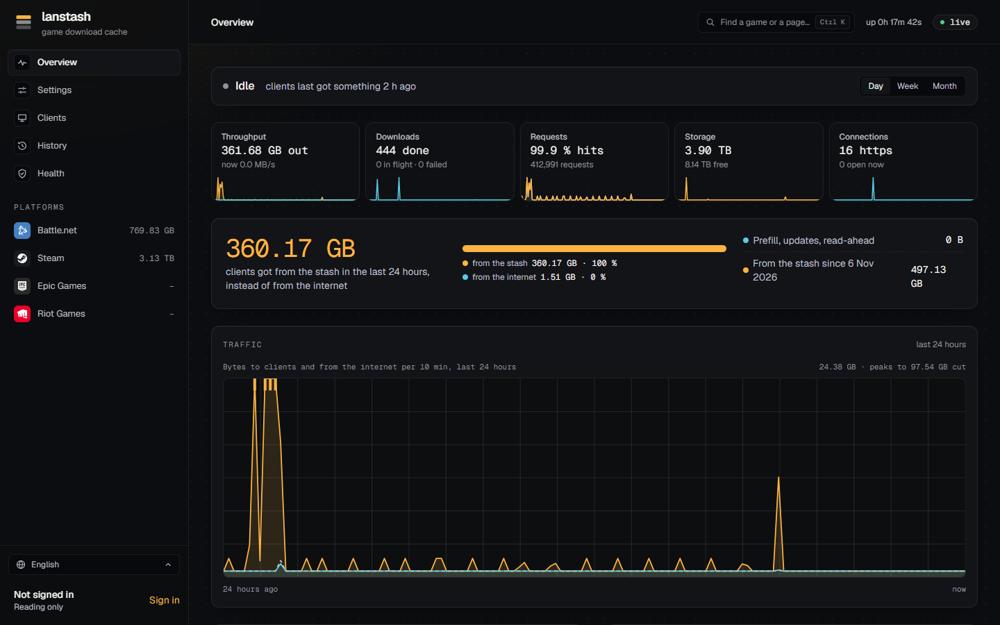
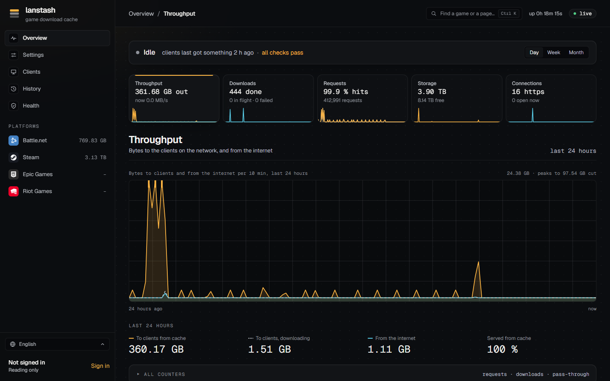
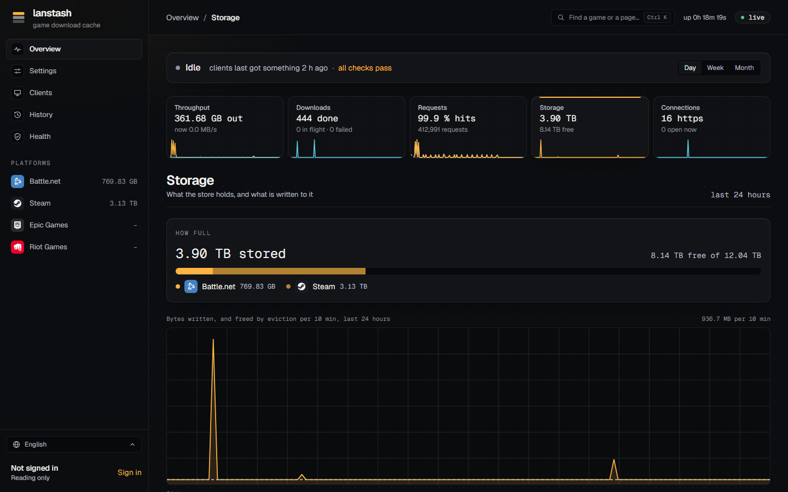
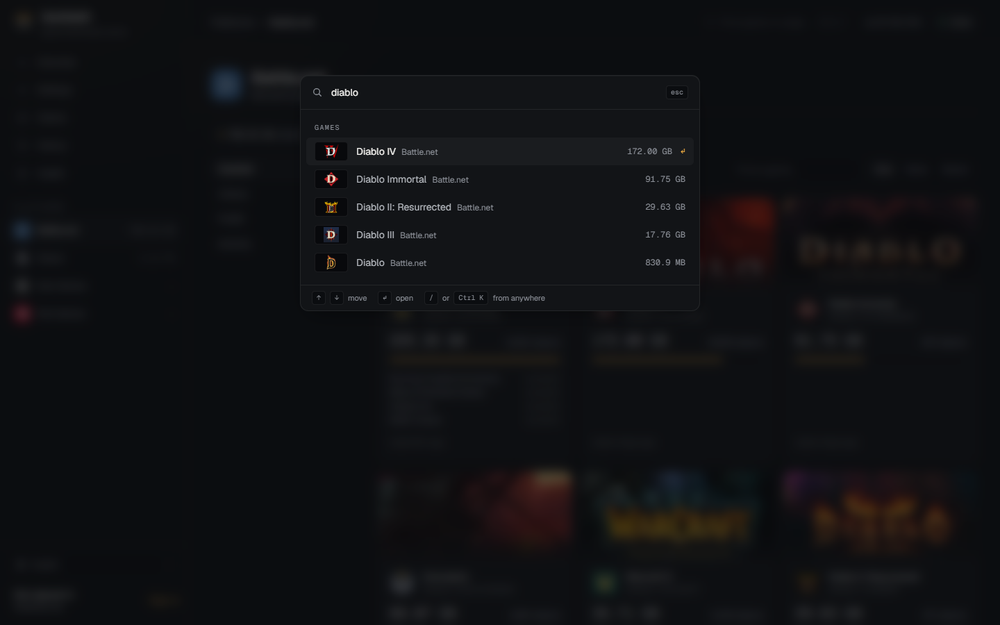

# Overview

The Overview is the first page the web UI shows: what lanstash is doing right now, how much your network got
from the stash instead of from the internet, and a tile for each resource it uses. Everything on it follows
one range, chosen at the top right, and updates live, about once a second.

## The status line

The line at the top says in a few words what lanstash is doing:

- **Serving** *n* **clients** with the rate in MB/s, **Downloading** *n* **objects** from the internet, or
  **Prefilling** *n* **games**;
- **Idle** when nothing moves, with when clients last got something;
- the health checks: **all checks pass**, or how many checks are failing and how many warnings there are (see
  [Health and checks](health.md)).

The header also shows how long lanstash has been up and whether the page is **live** (it reconnects on its own
when the connection drops).

## The range

**Day**, **Week** and **Month** (the last 24 hours, 7 days or 30 days) set the range for the whole page: the
tiles' charts, the savings panel, the traffic chart and each resource's page. lanstash keeps its counters by the
minute while it runs, for 180 days, so the charts survive a restart. Longer ranges are drawn in larger steps.

## The resource tiles

Each tile shows a figure, a short detail and a small chart over the range. Click a tile to open that resource's
own page.

| Tile | Shows |
|---|---|
| **Throughput** | Bytes sent to clients over the range ("out"), and the rate now. |
| **Downloads** | Objects lanstash fetched from the internet ("done"), with how many are in flight and how many failed. |
| **Requests** | The hit rate (requests answered from the stash) and how many requests clients made. |
| **Storage** | How much the store holds, and how much is free on the disk. |
| **Connections** | HTTPS connections lanstash relayed to the origin (it passes HTTPS through without caching it), and how many are open now. |

## From the stash instead of the internet

Under the tiles, a large figure says how much clients got from the stash over the range, **instead of from the
internet**. A bar splits what clients got into **from the stash** and **from the internet**, with the share of
each.

Beside it:

- **Prefill, updates, read-ahead**: what lanstash fetched on its own, not because a client asked.
- **From the stash since** a date: the total over lanstash's whole life. lanstash keeps this total across
  restarts.

## Traffic and the stash

The **Traffic** chart draws bytes to clients and bytes from the internet over the range. When one peak would
flatten everything else, the scale is cut and the chart says how high the peaks went ("peaks to ... cut").

Further down the page:

- **Downloading now**: the games clients are downloading at this moment, and which clients.
- **Most served**: the games clients got most of over the range.
- **The stash**: how full the store is, the largest games, and all games by platform.

## A resource's own page

Each tile opens a page with more detail for that resource:

- a **Live** strip while something moves (for example MB/s to clients and from the internet);
- the range's chart;
- the main figures over the range;
- **All counters**, folded: a table of every counter of that resource, each **over the range**, **since start**
  and **now**.

| Page | Main figures |
|---|---|
| **Throughput** | To clients from cache, to clients while downloading, from the internet, peak to clients, served from cache. |
| **Downloads** | Started, completed, failed, joined, CRC mismatches, store errors, origin 4xx and 5xx, timeouts, time to first byte. While objects download, a list shows each one with its progress. |
| **Requests** | Hit rate, requests, hits, misses, partial, retries, errors, refused, left by the client, sent from the file. |
| **Storage** | Written, evicted, stored now, free now, how full, segments and files evicted, eviction failures, and the store check. |
| **Connections** | HTTPS connections, pass-through requests (hosts lanstash does not cache), relayed, refused, bad hello, connect failed. |

The Storage page also shows the background **Store check**: when the store was last checked, how far a running
check has read, when the next check is due, and any damage found. See [Health and checks](health.md).

## The command palette

Press ++ctrl+k++ (++cmd+k++ on a Mac) or ++slash++ anywhere, or click **Find a game or a page...** in the
header, to open the palette. Type part of a name to jump to:

- a page (Overview, Clients, History, a platform's part, and so on);
- a game in the stash;
- a game in a platform's library that is **not cached** yet.

What you opened last is listed first, under **Used last**. Move through the results with the keyboard, open
one, or close the palette with ++esc++.

