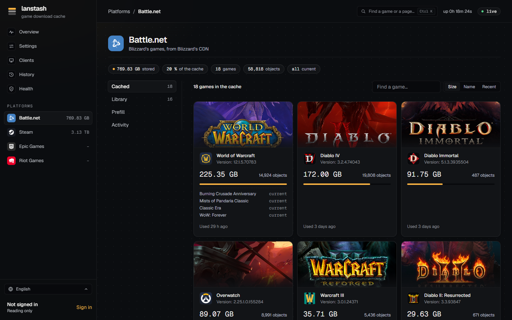
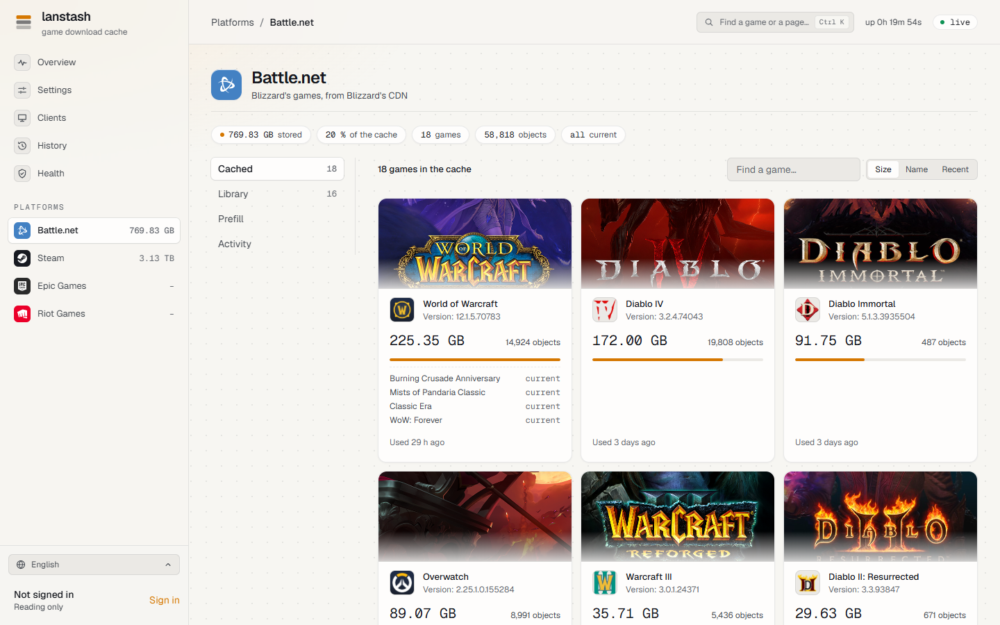
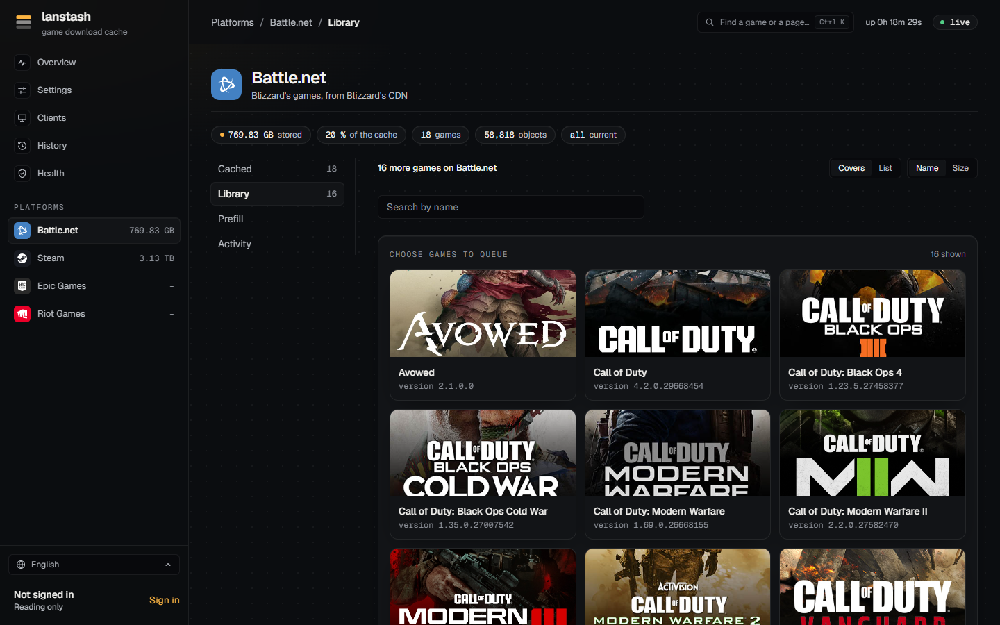
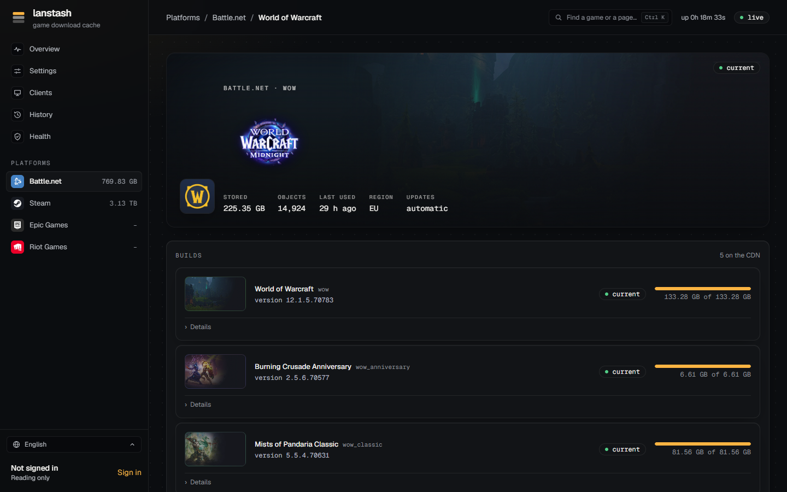
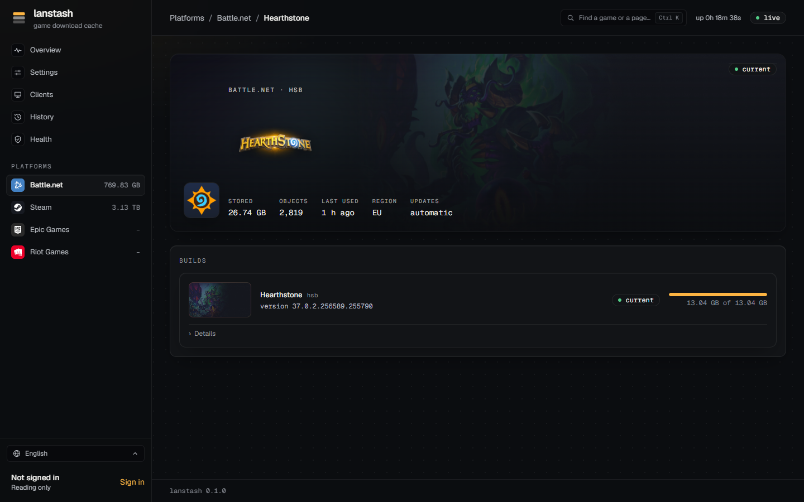
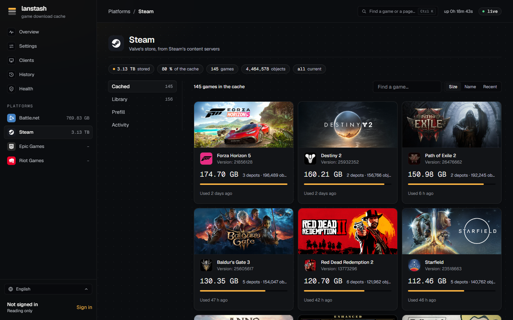
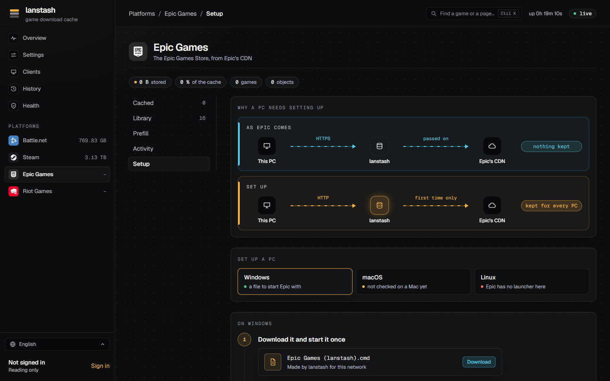

# Platforms and games

Each platform lanstash caches has a page of its own in the sidebar, under **Platforms**: Battle.net, Steam,
Epic Games and Riot Games. A platform's page shows what the stash holds of it and, where the platform allows,
the games your accounts own, prefills, and how to set up a PC. Each game has a page too, with its builds and
how much of each the stash holds.

!!! note
    The web UI follows your system's light or dark theme.

    

## A platform's page

### The chips

Under the platform's name, a row of chips sums it up:

- how much is **stored**, and the platform's share **of the cache**;
- how many **games** and **objects** the stash holds;
- whether games are **downloading** now;
- whether every game is **current** (**all current**), or which ones are behind.

### The parts

The list on the left switches between the platform's parts. A part shows only where the platform has it, and
some only for an account that may use them (see [Accounts](accounts.md)).

| Part | What it shows |
|---|---|
| **Cached** | The games in the stash, as covers with their size, version and when they were last used. Sort them by **Size**, **Name** or **Recent**, and find one with **Find a game...** (by its name, its id or a store code). When some games are behind, **Bring the games behind up to date** queues prefills for them, the smallest first. **Launcher data** (a launcher's own catalogs and configs) is listed apart. |
| **Library** | The games the platform offers that are not in the cache yet: for Steam and Epic Games, the games your signed-in accounts own; for Battle.net, every game in Blizzard's catalog. Choose games here to queue prefills; see [Prefill](prefill.md#choosing-games-in-the-library). |
| **Prefill** | The prefill running now, **Up next** (the queue) and **Past prefills**. See [Prefill](prefill.md). |
| **Account** | The platform accounts lanstash is signed in to (Steam and Epic Games). |
| **Activity** | What of this platform is downloading right now, and **About** the platform in lanstash: how its content arrives and how it is checked. |
| **Setup** | How to set up a PC for the platform (Epic Games). |

## A game's page

Click a game anywhere (a cover, the palette, History, Clients) to open its page.

### The hero

The top of the page shows the game's art, its platform and code, whether it is **current**, and its facts:

- **stored**: how much of it the stash holds;
- **objects**: how many objects that is;
- **last used**: when a client last got something of it;
- **region** (Battle.net): the region whose builds count;
- **updates**: **automatic** when lanstash keeps the game current on its own, **by hand** when not (see
  [Prefill](prefill.md#keeping-games-current-automatically)).

### Builds

**Builds** lists the game's current build and how much of it the stash holds, for example
"133.28 GB of 133.28 GB". A build is **current** once the stash holds all of what an install of it downloads.
**Details** opens what that build is made of: for Battle.net, whole files, archives, the requests a prefill sends
and files the CDN does not have.

- A **Pre-release** build shows up when Battle.net publishes one, which the launcher downloads ahead of a launch.
  Its **Pre-load** button puts it in the stash early.
- **Other products of the same directory** are listed as builds of their own. Battle.net files several games
  under one directory: World of Warcraft's page also lists World of Warcraft Classic flavours, each with its own
  version, product code and Prefill button.
- When the stash holds some of an install for another platform (say, macOS beside Windows), that install has a
  row of its own with how much of it is stashed. See [Prefill](prefill.md#downloading-for-another-platform-or-language).

### In the stash, and old builds

Beside the builds, for an account that may delete games:

- **In the stash** with **Delete...**: everything lanstash keeps of the game goes, and the next download of it
  comes from the internet again. A Steam game's depots go with it. lanstash asks once more before it deletes.
- **Old builds** with **Check** and **Prune...**: Check finds the files of builds no player gets any more (it
  can take a minute for a large game), for any platform or language. Prune deletes them. Files used in the last
  week are kept for now. lanstash also prunes on its own, one game at a time, about once an hour.

### Updates and who got it

- **Updates** lists the game's [History](history.md): its new builds, and when the stash came to hold them whole.
- **Who got it** lists the clients that got the game over the last 30 days, with how much each got and how much
  of it came from the cache. It shows for signed-in accounts only (see [Clients](clients.md)).

## What each platform needs

=== "Steam"

    Steam games are cached as soon as a PC downloads them; nothing else is needed for that.

    For the **Library**, prefills and build tracking, lanstash needs a Steam account signed in. Open the Steam
    page's **Account** part, choose **Sign in**, and scan the QR code with the Steam mobile app (Steam Guard
    shield, then the QR scanner), then approve the sign-in in the app. No password is involved: lanstash keeps
    only the sign-in Steam hands out. You can also sign in on lanstash's machine with `lanstash steam login`.

    - **Several accounts** may be signed in. Each one's games are fetched as that account, and the Library lists
      the games of all of them, with who owns each (**Owned by**).
    - A Steam game arrives as **depots**: its content split by platform and language, each stored on its own.
      The game's page and cover show its depots together, under the game's art.
    - Chunks are checked against the CRC Steam sends with them before they are kept.
    - **Settings** has a Steam group: the **Operating system**, **Languages** and **Architecture** your PCs use.
      Prefills, builds and sizes follow it.

    

=== "Battle.net"

    Battle.net needs no account. lanstash reads Blizzard's own catalog for names, art and the list of games.

    - Games are named by a **product code** (for example `hs` is Hearthstone, `osi` is Diablo II: Resurrected).
    - The **Library** lists every game in the catalog, so any Battle.net game can be prefilled before anyone
      downloads it.
    - Each game's current build is checked with Blizzard's patch service every few minutes, for the **Region**
      set in Settings. A game is current when the stash holds all of that build's install for the configured
      **Install tags** (platform, architecture, locale) and region.
    - Large archives are fetched in ranges, so a game a client downloaded is often only partly in the cache
      until it is prefilled.

=== "Epic Games"

    Epic's launcher downloads over HTTPS, which lanstash passes through but cannot keep. So each Windows PC needs
    setting up once before its Epic downloads are cached.

    1. Open the Epic Games page's **Setup** part and choose **Windows**.
    2. **Download** the file `Epic Games (lanstash).cmd` and start it once. Windows may ask whether to run a
       downloaded file: choose Run. It puts itself in place and makes a shortcut on the desktop and in the Start
       menu.
    3. Start Epic with that shortcut from now on, in place of Epic's own. Each time, it closes the launcher if it
       runs, adds a few lines to Epic's settings file (asking Windows for permission only where it must), then
       starts the launcher as usual.
    4. Check that it works: install or update a game. It shows under **Activity** while it downloads and under
       **Cached** once done. If it shows in neither, the launcher is still downloading over HTTPS.

    macOS is not checked yet, and Epic has no launcher for Linux.

    For the **Library** and prefills, sign lanstash in to an Epic account in the **Account** part: open Epic's
    sign-in page from there, sign in, and paste the code it shows back into lanstash. Several accounts may be
    signed in. Chunks from Epic's CDN are checked against the SHA-1 their build's manifest gives before they are
    kept.

    

=== "Riot"

    Riot games are cached only: there is no Library, prefill or build tracking for Riot. Riot has not been tried
    with a real Riot client yet.
