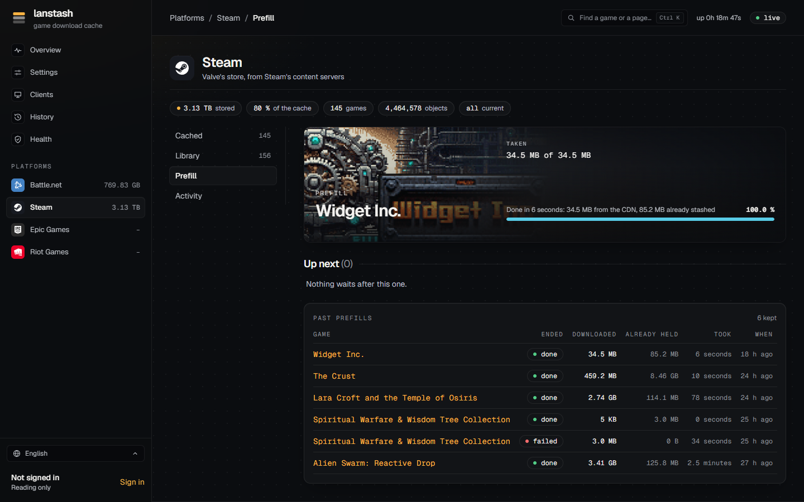
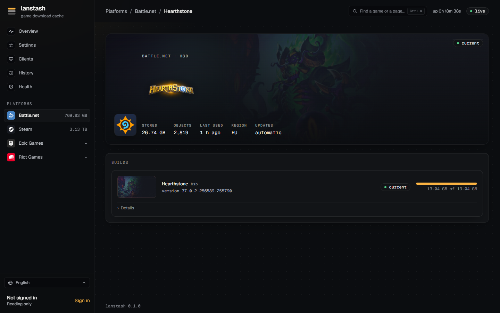

# Prefill

A prefill puts a game's current build into the stash before anyone asks for it, so the first PC that installs
it already gets it at LAN speed. lanstash can prefill Steam, Battle.net and Epic Games games, keep games current
on its own as new builds come out, and fetch an install for another platform or language than your PCs use.



!!! note
    Starting a prefill needs an account that may prefill: an admin may prefill any game, a player only the games
    its linked platform accounts own. See [Accounts](accounts.md).

## Starting a prefill

On a game's page, each build has a **Prefill** button (**Pre-load** for a pre-release build). When the platform
is already prefilling another game, the button says **Queue** instead and the game waits its turn.

A platform prefills one game at a time; the others wait in its queue. A prefill only fetches what the stash does
not hold yet, so prefilling a game that is partly stashed is quick.

## The Prefill part

Each platform's **Prefill** part shows:

- the prefill running now: how far it got, the network rate, and when it ends, what it took (for example "34.5 MB
  from the CDN, 85.2 MB already stashed");
- **Up next**: the games waiting, in the order they will run. **Remove** takes one out of the queue;
- **Stop...**: stops the running prefill. Stop forgets the games waiting after it too;
- **Past prefills**: every prefill that ended, with its state (**done**, **stopped**, **failed**), what it
  downloaded, what was **already held**, how long it took and when. lanstash keeps these across restarts.

## Choosing games in the Library

The **Library** part lists the games the platform offers that the stash does not hold yet: for Steam and Epic
Games, the games your signed-in accounts own; for Battle.net, every game in Blizzard's catalog.

1. Find games by name with **Search by name**, and show them as **Covers** or a **List**, sorted by **Name** or
   **Size**.
2. Click the games you want (or choose all those shown).
3. The bar at the foot says how many games are chosen, about how much a prefill downloads, and how much is free on
   the disk. When the games would take more than is free, eviction makes room (see
   [Health and checks](health.md#eviction)).
4. **Queue** *n* **prefills** queues them all.

On the **Cached** part, **Bring the games behind up to date** queues prefills of every stashed game whose
current build the stash does not hold whole, the smallest first, so games come up to date sooner.

!!! tip "Moving from lancache"
    When lanstash's configuration names lancache's old cache (`nginx_cache`), the Library and game pages also say
    how much of a game lancache holds, and offer **From lancache**: the prefill takes what lancache holds first,
    checked, and the rest from the CDN.

## Keeping games current automatically

With **Automatic updates** set (`auto_update`, in **Settings**), lanstash keeps games current on its own:

- every game whose current build the stash once held whole is followed from then on;
- when such a game gets a new build, lanstash queues a prefill of it from the CDN, behind whatever runs;
- `auto_update` is **always**, a daily **window** in UTC (`HH:MM-HH:MM`, for example `02:00-06:00`), or **off**.
  Outside the window nothing is queued.

A game's page says **updates: automatic** for a followed game and **by hand** for the others. Games never held
whole (imported only in part, say) are not followed, and neither is a game you deleted, until the stash holds it
whole again. A prefill that fails is not tried again until the next build or a restart.

## Downloading for another platform or language

Most networks have PCs of one kind, and lanstash prefills for what it is set up for. When a game has installs for
other platforms or languages (a Mac among Windows PCs, a German client among English ones), its page shows a
panel **Download for another platform or language**.

=== "Battle.net"

    - **Platform**: the platforms this build has installs for, such as Windows and macOS.
    - **Architecture**: shown when the platform has several; **any** takes every architecture of it.
    - **Language**: the languages this build has installs for; **as set up** keeps the configured one.

=== "Steam"

    - **Platform**: Windows, macOS or Linux, as the game installs for them.

**Prefill for** the chosen platform fills what that install takes and the stash lacks. The usual install is not
changed. A platform the stash already holds whole is marked **stashed**.

Once the stash holds some of another platform's install, the game's **Builds** list shows it as a row of its own,
with how much of it is stashed, beside the usual one.



## Prefilling from the command line

On lanstash's own machine, `lanstash prefill` starts a prefill in the running lanstash and follows it:

```sh
lanstash prefill steam/<app id>        # a Steam game by its app id
lanstash prefill blizzard/wow          # a Battle.net game by its product code
lanstash prefill blizzard/wow --pre    # its pre-release build
lanstash prefill stop                  # stop the running prefill
```

The platforms are `steam`, `blizzard` and `epicgames`. Progress is printed every 2 seconds; ++ctrl+c++ stops
following, not the prefill. `--detach` starts it without following, and `--from lancache` takes what lancache's
old cache holds first. The command exits with 1 unless the prefill ends done. All options are in the
[command line reference](../reference/cli.md).
