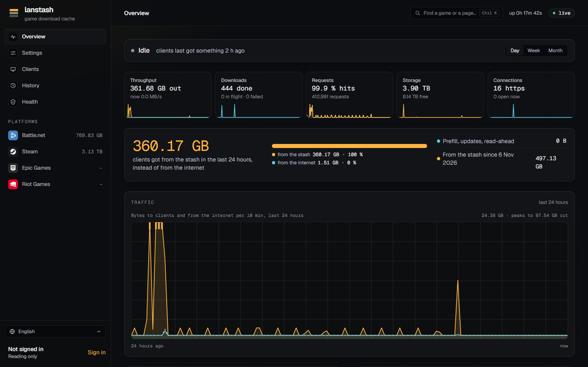
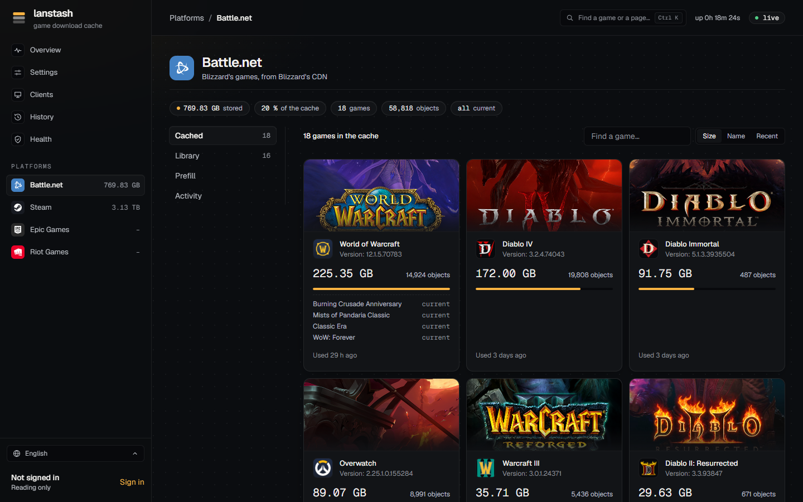
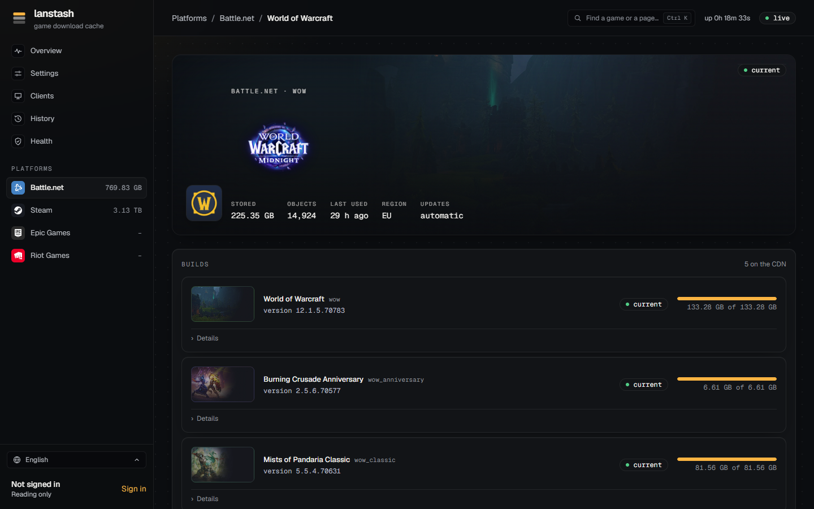
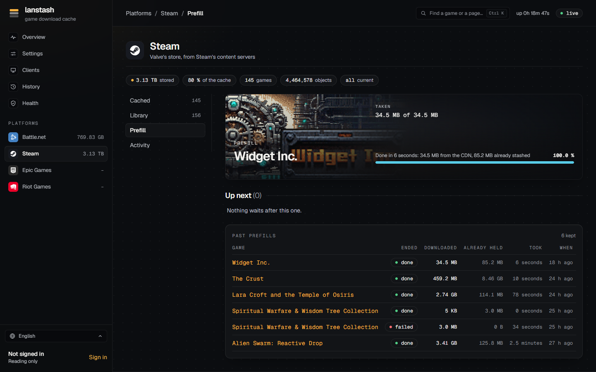
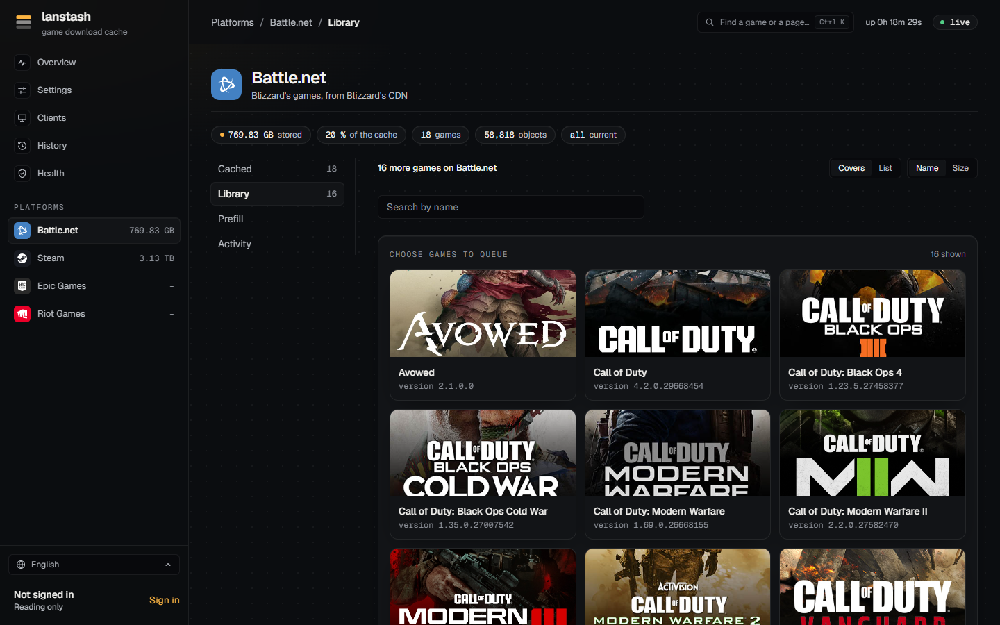
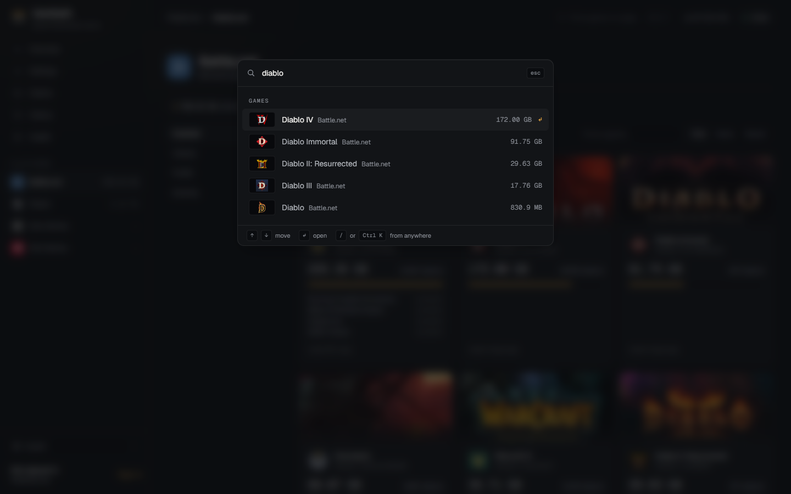
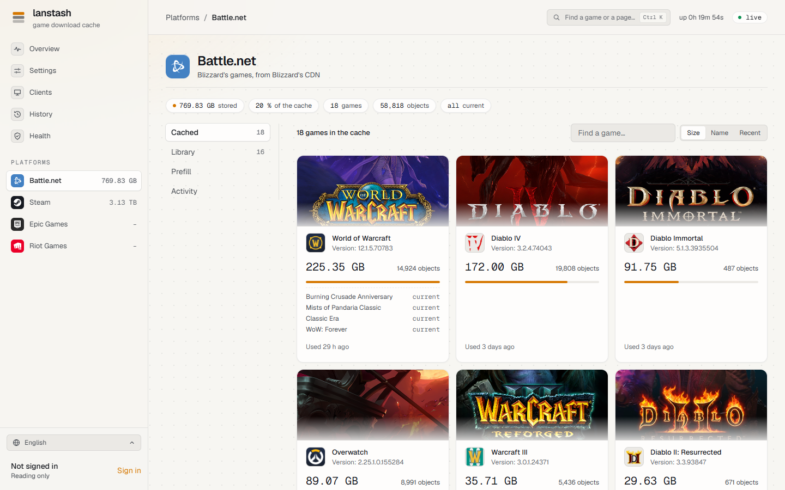

---
hide:
  - navigation
  - toc
---

<div class="hero" markdown>

# lanstash

**A game download cache for your LAN.** Download a game once; every other PC on the network gets it at LAN
speed, from your own storage. Steam, Battle.net, Epic Games and Riot.

[Get started](getting-started/index.md){ .md-button .md-button--primary }
[See the guide](guide/index.md){ .md-button }

</div>

{ .shot }

## What it does

<div class="grid cards" markdown>

-   :material-download-network: **Caches game downloads**

    ---

    PCs reach lanstash through your DNS, which points the platforms' download hosts at it. What one PC
    downloads, the next gets from the stash.

-   :material-harddisk: **Built for network storage**

    ---

    Small chunks are packed into large segment files, large archives go to sparse files, and stored bodies are
    sent with `sendfile`. Every stored byte carries a checksum.

-   :material-rocket-launch: **Prefills ahead of time**

    ---

    Put a game's current build into the stash before anyone plays it, keep held games up to date on their own,
    and fetch another platform's or language's install when a Mac or another locale joins the LAN.

-   :material-source-branch: **Knows every build**

    ---

    For each game, whether the stash holds its current build, how much of it, and which old files no current
    build needs any more.

-   :material-monitor-dashboard: **Shows what happens**

    ---

    Throughput, downloads, requests, storage and connections, live and over time; who downloaded what; a
    history of every update.

-   :material-account-lock: **Accounts and privacy**

    ---

    Admins, viewers and players; invite links; hidden games, and players' private games that others see only
    as "A hidden game".

</div>

## A look around

=== "A platform"

    { .shot }

=== "A game"

    { .shot }

=== "Prefill"

    { .shot }

=== "Library"

    { .shot }

=== "Search"

    { .shot }

=== "Light theme"

    { .shot }

## In one minute

```sh
sha256sum -c lanstash-<version>-linux-x86_64.tar.gz.sha256
tar -xzf lanstash-<version>-linux-x86_64.tar.gz && cd lanstash-<version>-linux-x86_64
sudo ./lanstash install --config lanstash.conf --web web
sudo lanstash user add admin --admin
lanstash doctor
```

Then point your DNS at it ([DNS](getting-started/dns.md)) and open the web UI on its admin port.
The [known limits](known-limits.md) say what it does not do yet.
